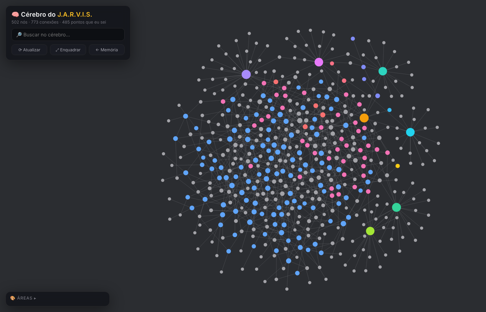
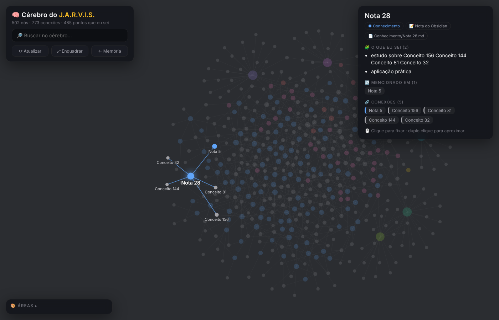

# J.A.R.V.I.S.

**A 100% private AI voice assistant that lives on your computer**, with an Obsidian "brain" of everything it knows about you. Talk naturally, say "Jarvis" anywhere in your sentence, and it answers out loud with a male, subtly robotic J.A.R.V.I.S. voice. It remembers across sessions, can look at your code and your machine (only if you allow it), and shows its knowledge as a living graph.

🔒 100% local processing. No subscriptions. No data harvesting. Sensitive info is redacted before anything is saved.

<p align="center">
  
  
</p>

## What it does

- **🗣️ Voice conversation** - Say "Jarvis" anywhere in a sentence, follow up without repeating the wake word, interrupt with "stop". It understands the ongoing conversation, so "Jarvis, what do you think?" just works.
- **🤖 J.A.R.V.I.S. voice** - Kokoro TTS on CPU: a male Brazilian Portuguese voice with a British butler tint and a light metallic colouring. Multilingual, and it starts speaking after the first sentence.
- **🧠 Obsidian brain** - Everything Jarvis learns becomes linked notes in an Obsidian vault, next to a skill map. The "🧠 Cérebro" window opens on launch and shows it as a round graph like Obsidian's graph view: names stay hidden until you hover a node, which then shows its name, every branch linked to it, and every point it holds.
- **📚 Your notes are its memory** - Point it at your own vault and your notes become part of what Jarvis recalls when answering.
- **💾 Long-term memory** - A self-organising knowledge graph plus a daily diary, so it remembers you across sessions.
- **🗂️ Code & system access (opt-in)** - Read-only look at the projects you grant (structure, search, files, outlines) and at your machine (OS, CPU, memory, disks, heaviest processes).
- **🧰 Built-in tools** - Web search (DuckDuckGo → Brave → Wikipedia, with page fetch), weather, screenshot OCR, local files, code inspection, system info, and a tool-discovery escape hatch for multi-step questions.

**🚧 Known limitations**
- Voice only, no text chat window.
- The brain view needs Qt WebEngine; on macOS bundled builds it opens in your browser instead.
- Location-aware answers need a free MaxMind GeoLite2 database (see Configuration).
- "Stop" said while Jarvis is speaking is sometimes filtered as echo.

## Quick start

1. Install [Ollama](https://ollama.com/download).
2. Run Jarvis from source:

```bash
git clone https://github.com/NateSando/JARVIS.git
cd JARVIS

bash scripts/run_desktop_app.sh      # Linux / macOS
scripts\run_desktop_app.bat          # Windows
```

(`scripts/run_linux.sh` / `run_macos.sh` run the voice assistant alone in the terminal, without the tray or the brain window.)

There are no setup screens. On launch Jarvis:
1. 🧠 opens the Cérebro window,
2. 🚀 starts the Ollama server if it isn't running,
3. 📥 downloads any missing models in the background (progress in the terminal and tray),
4. 🎤 starts listening. Say "Jarvis" and talk.

The first launch also downloads the Kokoro voice (~120 MB) and the Whisper model. Everything else is local.

## System requirements

| Hardware | VRAM | Model |
|----------|------|-------|
| Most users | 8GB+ | `gemma4:e2b` (default) |
| Better quality | 16GB+ | `gemma4:e4b` |
| High-end | 24GB+ | `gpt-oss:20b` |

The intent judge (`gemma4:e2b`) is always loaded alongside the chat model; the default chat model shares it, so no extra VRAM is needed.

## Configuration

Open **⚙️ Configurações** from the tray to change settings without editing JSON. Settings live in `~/.config/jarvis/config.json`.

<details>
<summary><strong>🧠 Obsidian brain</strong></summary>

Jarvis keeps an Obsidian vault in step with what it knows (default `~/Obsidian/JARVIS`, created on first start):
- `JARVIS/Cérebro.md` is the hub, `JARVIS/Habilidades/` holds one note per skill area (seeded from the system prompt, then yours to edit), and `JARVIS/Memória/` mirrors the knowledge graph.
- Open the folder as a vault in Obsidian to use its own graph view too ("🟣 Abrir cofre do Obsidian" in the tray).
- Point it at your existing vault to make your notes part of the brain and of Jarvis's recall. Jarvis only rewrites files it created.

```json
{
  "obsidian_enabled": true,
  "obsidian_vault_path": "~/Obsidian/JARVIS"
}
```

No Obsidian Sync or plugins are needed.

</details>

<details>
<summary><strong>🤖 Voice (Kokoro)</strong></summary>

```json
{
  "kokoro_voice": "pm_alex:0.7,bm_george:0.3",
  "kokoro_lang": "pt-br",
  "kokoro_robot_effect": 0.35,
  "kokoro_speed": 1.0
}
```

- `kokoro_voice` takes one voice (`"bm_george"`) or a weighted blend. List them with `cd src && python -m jarvis.voice.cli --list-voices`.
- `kokoro_robot_effect` goes from `0.0` (natural) to `1.0` (fully synthetic).
- `kokoro_lang` sets pronunciation (`pt-br`, `en-gb`, `en-us`, `es`, …).

</details>

<details>
<summary><strong>🗂️ Code & system access (opt-in)</strong></summary>

Both are **read-only and off by default**:

```json
{
  "code_access_roots": ["~/projetos/lexguard", "~/projetos/jarvis"],
  "system_access_enabled": true
}
```

Or use Configurações → "🔐 Code & System Access". Jarvis only reads inside the listed folders, never opens secrets (`.env`, keys, certificates, credential files), masks tokens and passwords in what it reads, and cannot write, delete or run anything. Process command lines and personal data are never reported.

</details>

<details>
<summary><strong>🎤 Speech recognition (Whisper)</strong></summary>

- **Multilingual** (default): `"whisper_model": "medium"`. English only: `"medium.en"`.

| Model | Multilingual | Download | VRAM | Speed |
|-------|--------------|----------|------|-------|
| Small | `small` | ~465 MB | ~2 GB | ~4x |
| **Medium** | `medium` | ~1.5 GB | ~5 GB | ~2x |
| Large V3 Turbo | `large-v3-turbo` | ~1.5 GB | ~6 GB | ~8x |

With an NVIDIA GPU, install `nvidia-cublas-cu12 nvidia-cudnn-cu12` for CUDA speech recognition; it's detected automatically.

Whisper hallucination filters: `"whisper_min_confidence": 0.3` and `"whisper_no_speech_threshold": 0.5`.

</details>

<details>
<summary><strong>🧭 Tool routing, planner and digests (advanced)</strong></summary>

- **Tool router** - `"tool_selection_strategy": "llm"` (default) asks a small model which tools fit each query; `"keyword"`, `"embedding"` and `"all"` are alternatives. `"tool_router_model"` overrides the model.
- **Planner** - decomposes multi-step questions before replying (`"planner_enabled"`, `"planner_model"`, `"planner_timeout_sec"`).
- **Digests** - small models get short relevance-filtered memory and tool-result notes (`"memory_digest_enabled"`, `"tool_result_digest_enabled"`: `null` = auto).

</details>

<details>
<summary><strong>📍 Location</strong></summary>

Location-aware answers (weather, local time) use a local GeoLite2 database; no cloud geolocation. Register for a free [MaxMind GeoLite2](https://www.maxmind.com/en/geolite2/signup) account, download the City database (MMDB) and save it to `~/.local/share/jarvis/geoip/GeoLite2-City.mmdb`, or set `"location_ip_address"` manually.

</details>

## Troubleshooting

<details>
<summary><strong>Common issues</strong></summary>

**"Ollama não encontrado"** - Install [Ollama](https://ollama.com/download) and launch Jarvis again.

**Jarvis doesn't hear me** - Check microphone permissions and speak after "Jarvis".

**Responses are slow** - Make sure you have enough VRAM for the chosen model.

**The brain window is blank** - Install `PyQt6-WebEngine`; without it the brain opens in your browser at `http://127.0.0.1:5050/cerebro`.

**Linux: no tray icon** - `sudo apt install libayatana-appindicator3-1`

</details>

## Privacy & storage

- **100% local** - Speech, replies, memory and the brain stay on your machine.
- **Auto-redaction** - Emails, tokens and passwords are removed before saving.
- **Local storage** - `~/.local/share/jarvis` plus the Obsidian vault folder you choose.
- **Stay fully offline** - set `"web_search_enabled": false`, `"wikipedia_fallback_enabled": false` and `"location_enabled": false`.

## License

- **Personal use**: Free forever
- **Commercial use**: [Contact us](mailto:baris@writeme.com)
