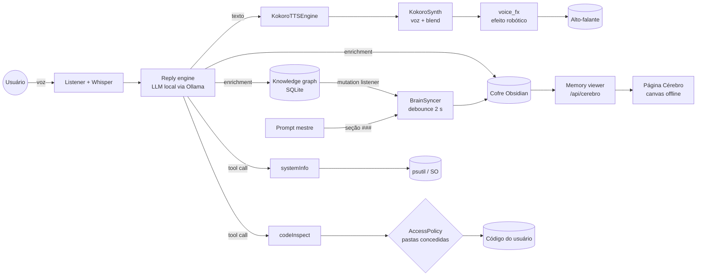
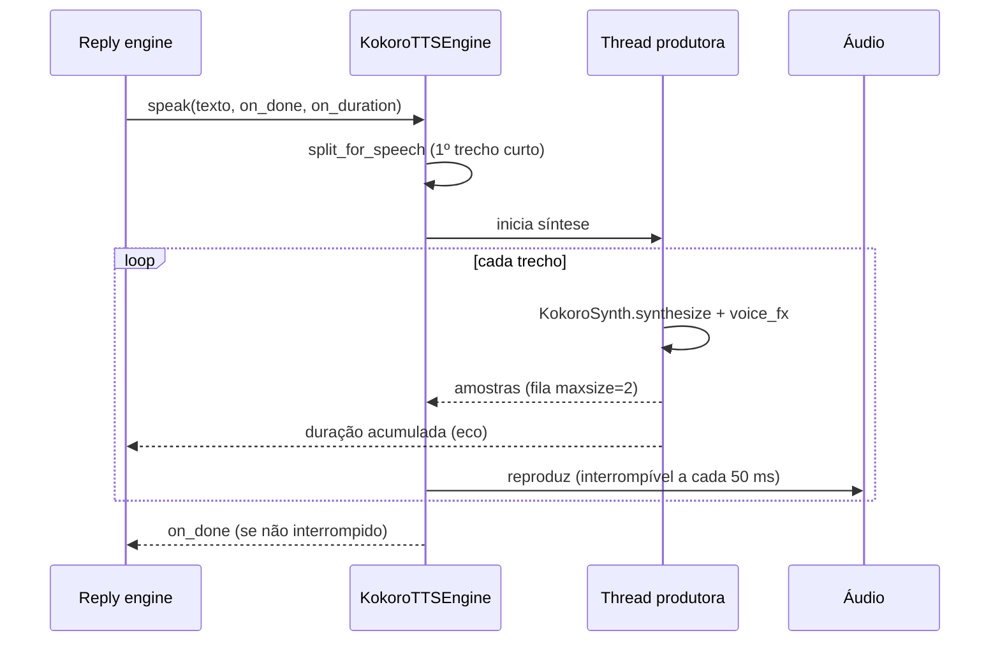
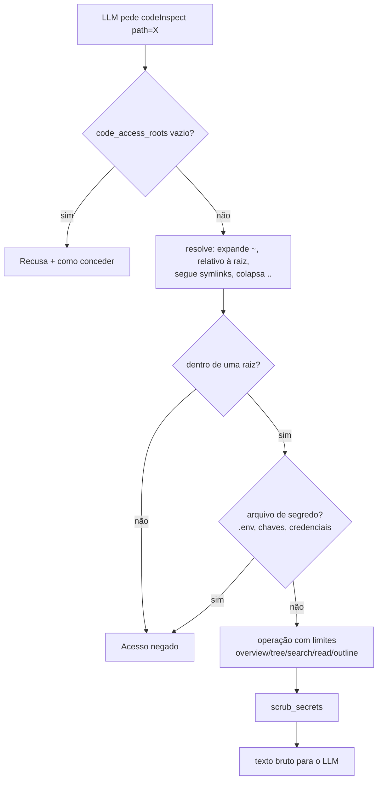

# Mudanças de Arquitetura: Voz J.A.R.V.I.S., Cérebro Obsidian e Acesso a Código/Sistema

## 1. Resumo Executivo

Três capacidades foram adicionadas ao JARVIS:

1. **Voz J.A.R.V.I.S. (Kokoro)**: TTS multilíngue em CPU, voz masculina (mistura `pm_alex` + `bm_george`) com coloração robótica ajustável e síntese em streaming (a fala começa após a primeira frase). Passa a ser o motor padrão; Piper e Chatterbox continuam disponíveis.
2. **Cérebro Obsidian**: tudo o que o JARVIS aprende vira notas Markdown ligadas num cofre Obsidian, junto com um mapa de habilidades gerado a partir do prompt mestre. A página "🧠 Cérebro" mostra o cofre como uma esfera viva no estilo do graph view do Obsidian; nomes aparecem só no hover (o nó e as ramificações ligadas a ele). As notas do usuário também entram na memória das respostas.
3. **Acesso a código e sistema (opt-in, somente leitura)**: as ferramentas `codeInspect` e `systemInfo` permitem ao JARVIS entender a estrutura dos projetos do usuário e o estado da máquina, apenas depois de permissão explícita.

Problema resolvido: o assistente não tinha voz em português com a persona pedida, não tinha uma representação navegável do conhecimento e não podia responder sobre o código e o computador do usuário.

## 2. Arquitetura e Fluxo de Dados

### 2.1 Visão geral



### 2.2 Voz (streaming)



### 2.3 Cérebro

- `brain/vault.py` lê o cofre (wikilinks, tags, frontmatter, pontos) com cache por arquivo (mtime + tamanho).
- `brain/sync.py` semeia `JARVIS/Habilidades/` (uma vez; depois a nota é do usuário), espelha o grafo em `JARVIS/Memória/` e regenera `JARVIS/Cérebro.md`. Só reescreve arquivos com `jarvis_id`.
- `brain/brain_map.py` produz nós, links e áreas para a página; links sem nota viram nós "conceito" (como no Obsidian).
- A página usa física própria: disco único de partida + gravidade central + repulsão local em grade espacial + molas nos links, resultando numa esfera redonda. Cada quadro é ~O(n); grafos grandes param de redesenhar quando estabilizam.

### 2.4 Acesso a código e sistema



## 3. Arquivos Criados/Modificados

| Arquivo | Motivo |
|---------|--------|
| `src/jarvis/output/voice_fx.py` | Efeito robótico em NumPy vetorizado (comb metálico, doubler, ring mod leve, casamento de loudness, proteção de pico) |
| `src/jarvis/voice/tts_kokoro.py` | `KokoroSynth` compartilhado (download, blend de vozes, síntese), `split_for_speech`, `parse_voice_spec` |
| `src/jarvis/output/tts_kokoro.py` | Motor do daemon com streaming produtor/consumidor e mesma interface do Piper |
| `src/jarvis/output/tts.py`, `src/jarvis/daemon.py` | Fábrica e inicialização do motor `kokoro` |
| `src/jarvis/config.py` | `kokoro_*`, `obsidian_*`, `code_access_roots`, `system_access_enabled` |
| `src/jarvis/voice/cli.py`, `pipeline.py` | CLI de voz usa o prompt mestre e a voz do config |
| `src/jarvis/brain/*` | Cofre, sincronização, mapa do cérebro, recall do cofre, spec |
| `src/jarvis/reply/engine.py` | Notas do cofre entram junto com o grafo no enrichment |
| `src/desktop_app/brain_page.py` | Página do cérebro (canvas offline) |
| `src/desktop_app/memory_viewer.py`, `app.py` | Rotas `/cerebro` e `/api/cerebro`, ação "🧠 Cérebro" na bandeja |
| `src/desktop_app/themes.py` | Cores `graph_*` do cérebro |
| `src/desktop_app/settings_window.py` | Seções Kokoro, Obsidian e "Code & System Access" |
| `src/jarvis/tools/builtin/code_access/*` | `AccessPolicy`, varredura, `codeInspect`, `systemInfo`, spec |
| `src/jarvis/tools/registry.py` | Registro das novas ferramentas |
| `jarvis_desktop.spec` | Empacotamento do Kokoro/espeak-ng e dos novos módulos |
| `README.md`, `CLAUDE.md`, `docs/llm_contexts.md`, specs | Documentação |
| `tests/...`, `evals/test_tool_selection.py` | Testes de comportamento e casos de eval de roteamento |

## 4. Decisões de Engenharia e Segurança (ADR)

**ADR-1: Kokoro ONNX em CPU como padrão.** Multilíngue (pt-br), sem PyTorch, ~120 MB. Alternativas: Piper (só inglês na configuração atual), Chatterbox (GPU/PyTorch pesado). Trade-off: síntese mais lenta que Piper, mitigada com streaming por frases.

**ADR-2: Blend de vetores de estilo em vez de outro modelo.** Pronúncia vem do idioma (`kokoro_lang`), timbre do blend. Permite "sotaque de mordomo" sem trocar de modelo nem custo extra de inferência.

**ADR-3: O cofre Obsidian é a única representação em disco do cérebro.** A página, o recall e o Obsidian leem os mesmos arquivos; não há banco paralelo para divergir. Arquivos do usuário nunca são alterados (só os com `jarvis_id`).

**ADR-4: Canvas próprio em vez de d3/CDN.** Funciona offline (privacidade em primeiro lugar) e permite otimizações específicas (lotes por cor, grade espacial, parada de redesenho quando ocioso).

**ADR-5: Acesso somente leitura, opt-in, por allowlist de pastas.** Seguindo zero-trust para agentes: nenhuma execução de shell, escrita ou exclusão. Caminhos são resolvidos (symlinks e `..`) antes da checagem, bloqueando traversal e escapes. Arquivos de segredo são recusados por nome e o conteúdo lido passa por `scrub_secrets`. `systemInfo` omite linhas de comando, variáveis de ambiente, usuário e rede. Trade-off: o JARVIS não corrige código sozinho; ele aponta onde e como, e o usuário aplica.

**ADR-6: Ferramentas registradas mesmo sem permissão.** Assim o roteador ainda as escolhe e o JARVIS pode dizer exatamente qual configuração liberar, em vez de alucinar uma resposta.

**ADR-7: Recall do cofre sem nova chamada de LLM.** Busca lexical com folding Unicode (independente de idioma) e o mesmo gate do grafo; os resultados passam pelo digest existente. Sem custo extra de latência.

## 5. Guia de Execução e Validação

Não há variáveis de ambiente novas nem segredos: tudo é configurado em `~/.config/jarvis/config.json` ou na janela de configurações.

```json
{
  "tts_engine": "kokoro",
  "kokoro_voice": "pm_alex:0.7,bm_george:0.3",
  "kokoro_lang": "pt-br",
  "kokoro_robot_effect": 0.35,
  "obsidian_enabled": true,
  "obsidian_vault_path": "~/Obsidian/JARVIS",
  "code_access_roots": ["~/projetos/lexguard"],
  "system_access_enabled": true
}
```

Testes:

```bash
python -m pytest tests/test_voice_fx.py tests/test_kokoro_tts.py tests/test_obsidian_brain.py \
  tests/test_memory_viewer_brain_api.py tests/tools/builtin/test_code_inspect.py \
  tests/tools/builtin/test_system_info.py tests/test_enrichment.py -q
```

Evals (precisam do Ollama rodando):

```bash
python -m pytest evals/test_tool_selection.py -v
```

Validação manual:
1. 🔊 `cd src && python -m jarvis.voice.cli --list-voices` e depois `python -m jarvis.voice.cli` para ouvir a voz.
2. 🧠 Abrir "🧠 Cérebro" na bandeja; passar o mouse num nó mostra o nome dele e das ramificações ligadas.
3. 🟣 Abrir `~/Obsidian/JARVIS` como cofre no Obsidian e conferir o graph view.
4. 🗂️ Conceder uma pasta em "Code & System Access" e perguntar: "Jarvis, como está estruturado o meu projeto?"
5. 🖥️ Ativar "System Information" e perguntar: "Jarvis, o que está consumindo memória?"
